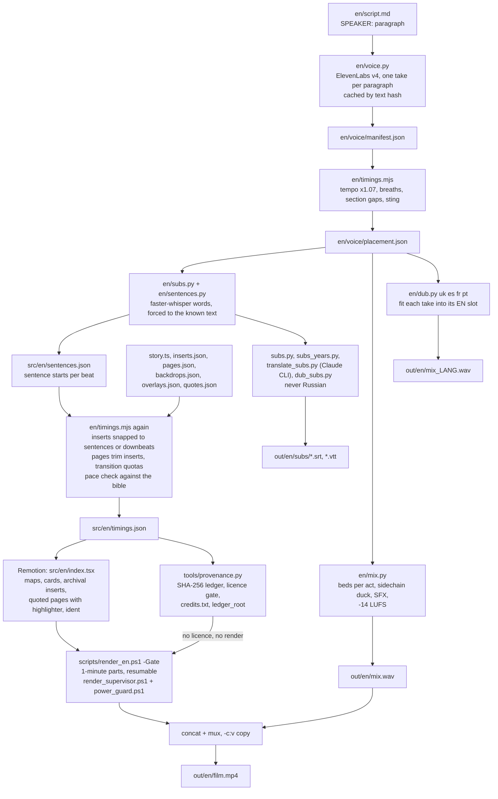

# render-engine

**Claude Code editing workflow:** run `/montage <desired edit>` in this repository.
Project agents route discovery to Haiku, implementation to Sonnet, and difficult decisions to Opus.
See [the workflow guide](docs/AGENT_WORKFLOW.md) and [project instructions](CLAUDE.md).

[](https://github.com/heisssen/render-engine/actions/workflows/ci.yml)
[](https://github.com/heisssen/render-engine/actions/workflows/codeql.yml)

A config-driven documentary render engine. You write a script; it voices it (ElevenLabs), finds every sentence in
the audio (whisper), plans the edit from a written editing bible, draws the maps and cards in Remotion, mixes the
sound, dubs it into other languages, subtitles it, and renders a 25-minute film in one-minute parts that survive a
dead laptop battery. Then it muxes the picture and the sound with `-c:v copy`, because re-encoding a finished film
is how you lose an afternoon.

[Українською](README.uk.md) · [Architecture](docs/ARCHITECTURE.md) · [War stories](docs/LESSONS.md) ·
[Threat model](docs/threat-model.md) · [Security](SECURITY.md) · [Changelog](CHANGELOG.md) ·
[Contributing](CONTRIBUTING.md) · [Adopters](ADOPTERS.md)

> **Status: built for one channel, works on Windows, expect rough edges.** This is the engine behind a single
> 25-minute history episode, extracted and cleaned up so other people can read it, run it and steal from it.
> It has been used in anger exactly once. The scripts assume PowerShell, a laptop and a patient owner.

The first episode was made for the history channel Switchyard. The writers' room behind its script (an audience
panel and research tools) is a separate project that is not public yet. This repo stands on its own: the bibles it needs are copied into `docs/bibles/`. The channel's look (signal-box ident,
staff maps on old paper, railway red) ships here as the example preset: `BRAND` and the palette in
`src/en/theme.ts`, plus `brand.tsx`, `Ident.tsx`, `ChannelArt.tsx` and `Thumbs.tsx`. Rename it, recolour it, keep
the trains or don't.

## What it does

- **Voice.** Each paragraph of `en/script.md` (`SPEAKER: text`, ElevenLabs v4 audio tags in `[brackets]`) becomes one
  take. Takes are cached by a hash of model + voice + seed + text, so editing one paragraph re-voices one paragraph.
- **Alignment.** faster-whisper transcribes each take; the known script text is forced onto the word timings, which
  gives the start of every sentence in every paragraph.
- **The edit plan.** `en/timings.mjs` lays the takes end to end with breaths and section pauses, cuts archival film
  into each beat on sentence boundaries (or on the music's downbeat when no sentence is near), lays quoted book pages
  over the lines they quote, picks one transition per cut under hard quotas, and prints a pace report against the
  limits in the documentary bible.
- **Picture.** Remotion draws one visual per paragraph: animated staff maps (1914 borders, Natural Earth coast,
  rivers, baked relief, railway network, arrows, fronts, units), cards (quotes, telegrams, documents, headlines, bar
  charts, people), archival photos and film with a period grade, scanned pages with a highlighter, an ident, act
  breaks, an end screen.
- **Sound.** `en/mix.py` places the voice, adds breaths a human narrator would take, runs a voice chain, lays one
  music bed per act, ducks it like a sidechain compressor, drops it out at the story's switch points, synthesizes
  the ident's lever-and-relay effects, and normalises to -14 LUFS.
- **Dubs.** `en/dub.py` voices a translated script with the same speakers and fits every take into its English slot
  (speeding up to 1.25x at most), so the picture never changes.
- **Subtitles.** Plain phrase captions from the known text on whisper timings, spoken years turned back into digits,
  translations through the local Claude CLI in cached batches, dub subtitles timed on the dub itself. Russian is
  refused in code.
- **Provenance.** `tools/provenance.py` hashes every file the film uses, traces each to its source and licence,
  writes the credit block, and blocks the render if anything has no usable licence.
- **Render.** One-minute parts, resumable, with a supervisor that restarts a crashed render and a battery guard that
  freezes the workers at 15% and thaws them at 40%.

## What is novel here

1. **Sentence-snapped editing driven by a written bible, with an automatic pace check.** The editing rules are prose
   documents (`docs/bibles/`): cut on sentences, never mid-phrase; at most 12 dissolves; 3 to 6 match cuts; one
   flash, one whip; no shot over 25 s on a map or 12 s on film. `timings.mjs` turns those rules into frame numbers
   and then grades its own work, printing every beat that breaks a limit. The edit is reproducible: change a
   sentence, re-run, and every cut that depended on it moves with it.
2. **Quoted-page inserts verified against scans.** When the narrator quotes a memoir, the real printed page appears
   with a highlighter running over the exact lines. Every quote in `public/docs/memoirs/quotes.json` was checked
   word for word against the scan (OCR text layer plus a look at the image), with the highlight box measured in
   image pixels. A German page gets its English line beside it. The engine refuses to build if a page id is missing.
3. **Dub fitting into the original timing slots.** A dub never gets its own edit. Each translated take is measured
   against the gap between its English start and the next paragraph's start, sped up only as much as needed, and
   placed on the same frame. One picture, five soundtracks, overruns reported by paragraph.
4. **Resumable minute-part rendering with a power and battery guard.** A 25-minute film renders as 26 independent
   parts; a power cut costs at most one minute of work. A supervisor restarts the renderer, a lock stops two from
   running, and a battery guard freezes the render processes before the laptop dies and thaws them once it has
   charged, so the minute in progress survives too.
5. **A per-asset provenance ledger with a licence gate.** Every clip, photo, page scan, music bed, effect and voice
   take gets a SHA-256, its place in the film, its source and its licence. Public domain passes; CC BY and BY-SA
   pass and land in the credits; NC, ND, rights-managed and unknown licences stop the render. One `ledger_root`
   hash covers the lot, so anyone can check that a published film matches its ledger.

## The pipeline



## Quickstart (Windows, PowerShell)

You need Node 20+, Python 3.12 (`py -3.12`), ffmpeg/ffprobe on PATH, an ElevenLabs account for voicing, and,
for subtitle translation, the Claude Code CLI logged in. `uv` works fine if you prefer it to pip.

```powershell
git clone https://github.com/heisssen/render-engine; cd render-engine
npm install
py -3.12 -m pip install numpy scipy pillow faster-whisper
copy .env.example .env          # then fill in ELEVENLABS_API_KEY and, optionally, NARRATOR_VOICE_ID
node scripts/fetch_fonts.mjs    # Google Fonts (OFL) into public/fonts, writes src/en/fonts.json
node scripts/fetch_geo.mjs      # 1914 borders (historical-basemaps, GPL-3.0) into src/en/geo/world1914.json
node scripts/check_imports.mjs  # every relative import resolves
py -3.12 en/terrain.py; py -3.12 en/bake_relief.py   # map relief from open elevation tiles
# put any paper texture you like at public/paper_texture.jpg (the maps are printed on it)
npm run studio                  # Remotion Studio on the EP01 data
```

The repo has no media, so be gentle with your expectations. The maps and cards are drawn from data and render as
they did in the film: open the `MapStills` composition in Studio for every map beat of EP01, one per frame. The full
`MainEN` timeline needs the clips, photos and scans the data refers to; until you add them, those beats error out.
`public/README.md` lists what goes where. Voice takes, music and SFX are not included either, so `timings.mjs` and
`mix.py` need your own takes and beds before they run (the committed `timings.json` lets Studio work without them).

## Command reference

| Step | Command | Reads | Writes |
|---|---|---|---|
| Fonts | `node scripts/fetch_fonts.mjs` | `@remotion/google-fonts` | `public/fonts/*.woff2`, `src/en/fonts.json` |
| 1914 borders | `node scripts/fetch_geo.mjs [--force]` | historical-basemaps on GitHub | `src/en/geo/world1914.json` |
| Relief | `py -3.12 en/terrain.py [--z 7]` then `py -3.12 en/bake_relief.py` | AWS Terrain Tiles | `public/relief_*.png`, `relief_baked.webp`, `src/en/geo/relief.json` |
| Voice | `py -3.12 en/voice.py [--only 12] [--jobs 3]` | `en/script.md`, `.env` | `en/voice/NNN_SPEAKER_hash.mp3`, `manifest.json` |
| Timings | `node en/timings.mjs` | manifest, story, inserts, pages, backdrops, overlays, sentences, clips | `src/en/timings.json`, `en/voice/placement.json`, pace report |
| Subtitles EN | `py -3.12 en/subs.py [--model medium.en]` then `py -3.12 en/subs_years.py` | manifest, placement | `out/en/subs/en.srt/.vtt/.json` |
| Sentences | `py -3.12 en/sentences.py` | whisper cache, placement | `src/en/sentences.json` |
| Translations | `py -3.12 en/translate_subs.py [uk es] [--model haiku]` | `out/en/subs/en.json` | `out/en/subs/LANG.srt/.vtt` |
| Mix | `py -3.12 en/mix.py [--placement P] [--out W]` | placement, takes, `public/music`, `public/sfx` | `out/en/mix.wav` |
| Dub | `py -3.12 en/dub.py uk es fr pt [--no-mix]` | `en/script_LANG.md`, placement | `en/voice_LANG/`, `placement_LANG.json`, `out/en/mix_LANG.wav`, `audio_LANG.m4a` |
| Dub subtitles | `py -3.12 en/dub_subs.py uk es fr pt` | dub placement and takes | `out/en/subs/dub/LANG.srt/.vtt` |
| Re-encode clips | `py -3.12 scripts/reencode_clips.py` | `public/clips/**/*.mp4` | same files, 30 fps, `-g 30 -bf 0` |
| Provenance gate | `py -3.12 tools/provenance.py [--strict] [--sources S.json] [--no-hash] [--report-only]` | timings, story, quotes, people, sidecars, media files | `out/provenance/en/ledger.jsonl`, `ledger.md`, `credits.txt`, `summary.json`; exit 1 if blocked |
| Tests | `py -3.12 -m unittest discover tests` | tiny fixtures | nothing, ideally |
| Reach snapshot | `py -3.12 scripts/evidence_snapshot.py` | GitHub API via `gh` | `evidence/YYYY-MM-DD.json` |
| Parallax (optional) | `%DEPTHFLOW_PYTHON% en\parallax.py IMAGE` | a real photo or painting | `public/parallax/NAME.mp4` |
| Studio | `npm run studio` | everything | nothing, it just looks nice |
| Full render | `powershell -File scripts/render_en.ps1 [-Gate] [-Concurrency 4] [-Bundle out/bundle] [-Out out/en/film.mp4]` | bundle, timings, mix | `out/en/parts/partNN.mp4`, the film |
| Keep it alive | `powershell -File scripts/render_supervisor.ps1` | `out/en/render.log` | restarts, `out/tmp/supervisor.log` |
| Battery guard | `powershell -File scripts/power_guard.ps1` | battery WMI | `out/tmp/power.log` |
| Preview | `powershell -File scripts/preview_en.ps1 -Bundle out/bundle -From 0 -To 2399` | bundle, mix | `out/en/preview.mp4` |
| Map speed A/B | `powershell -File scripts/bench_map.ps1 -Bundle out/bundle` | bundle | seconds per frame per switch |

The usual loop after a script change: `voice.py` → `timings.mjs` → `subs.py` → `sentences.py` → `timings.mjs` →
`mix.py` → `provenance.py` → render. Yes, timings runs twice: the first pass places the takes so whisper knows where they are, the
second snaps the cuts to the sentences whisper found.

## Where things live

Paths are the ones the first episode used; nothing was moved, so every script still works as it did in production.

```
src/en/          Remotion code (index.tsx registers the compositions) + episode data (story.ts, *.json)
src/en/geo/      Natural Earth coast, rivers, lakes (public domain); world1914.json is fetched, not committed
en/              pipeline scripts (Python + timings.mjs) + the episode's scripts (script*.md) and footage.md
en/voice/        manifest.json and placement.json are committed; the takes themselves are not
public/          media root for Remotion's staticFile(); only small JSON manifests are committed
scripts/         render, supervisor, battery guard, preview, benchmarks, fetchers, checks
docs/            architecture, lessons, the editing/motion/writing bibles, a GitHub Pages index
```

**Episode data lives in** `src/en/story.ts`, `src/en/*.json` (inserts, pages, backdrops, overlays, sentences,
timings, photo aspects), `en/script*.md`, `en/voice/manifest.json`, and three manifests under `public/`
(`clips/people/people.json`, `docs/memoirs/quotes.json`, `music/.NAME.beats.json`). EP01 ships as the worked example.

## Data formats

**`en/script.md`.** Blank-line separated paragraphs. `## SECTION` lines mark structure (sections starting `COLD OPEN`
and `ACT` matter: the sting goes after the cold open, act breaks before each later act). Spoken lines are
`SPEAKER: text` with ElevenLabs tags like `[quiet]`. `<!-- comments -->` are ignored. Speakers must exist in
`VOICES` in `en/voice.py`.

**`src/en/story.ts`.** `STORY` is one beat per spoken paragraph, same order. Each beat is one of:

| kind | what it is | key fields |
|---|---|---|
| `map` | animated staff map | `view`, `from` (camera start), `layers`, `keep`, `cap`, `stat`, `title` |
| `photo` | archival photo with a move | `src`, `credit`, `move`, `focus`, `mount`, `circle`, `cap` |
| `film` | archival film | `src` (under `public/clips`, no extension), `from`, `rate`, `credit`, `cap` |
| `quote` | a line on screen | `text`, `who`, `pre` |
| `telegram` | a telegram form (typewriter SFX in the mix) | `head`, `text`, `stamp`, `reply` |
| `doc` | a stamped document (stamp SFX) | `head`, `title`, `lines`, `stamp` |
| `headline` | a newspaper front | `paper`, `head`, `sub` |
| `big` | one big line | `lines`, `sub` |
| `bars`, `stats`, `versus`, `options`, `people`, `blocs` | chart and comparison cards | see `CardSpec` in `Cards.tsx` |

Map layers: `front`, `arrow`, `region`, `note`, `city`, `fort`, `country`, `cross`, `ring`, `unit`, `route` (a
train along the 1914 lines in `rail1914.ts`); each has an `at` (0..1 of the beat) for when it appears. Any beat can
carry `mode` (`real` / `alt` / `both`, the timeline badge), `year`, and `bg` (film under a card). The helpers
`ph()`, `film()` and `map()` exist because typing `k: 'photo'` 24 times builds character but not films.

**`src/en/inserts.json`.** `{ "beat": [ {clip | photo, from_s, at | atf, len, burst, rate, credit, move, focus, look, label} ] }`.
`at` is seconds from the beat start, `atf` a fraction of the beat. The start snaps to the nearest sentence start
within 2.5 s; the end to a sentence start, else to the music's beat within 20 frames. `burst: true` turns snapping
off for montage. Keys starting with `_` are comments.

**`src/en/pages.json`.** `{ "beat": [ {page, sent, n} ] }`: show quote `page` from sentence `sent` for `n` sentences
(omit `n` for the rest of the beat). Film inserts under a page are trimmed, or dropped if under 3 s would remain.

**`public/docs/memoirs/quotes.json`.** One entry per verified quote: `id`, `file` (the scan), `author`, `work`,
`edition_year`, `page`, `language`, `original_text`, `english_text`, `highlight_box` `[x0, y0, x1, y1]` in image
pixels, `image_size`, `source_url`, `license`, `credit`, `cite`, `who`. See the README next to it for the method.

**`src/en/backdrops.json`.** `{ "beat": {photo | clip, from_s, credit} }`: a picture under a card beat.

**`src/en/overlays.json`.** `tease` (the flash-forward shots before the first word), `keywords` (words slammed on
screen when the narrator says them; empty in EP01, the bible switched them off), `chapters` (a corner tag from a beat on).

**`public/clips/people/people.json`.** `clips: [{id, person, year, credit, source_url, license, ...}]`: a person's name
label appears on their first film appearance only.

**`public/music/.NAME.beats.json`.** `{bpm, beat_times, downbeats, total_duration}` for each music bed, from any beat
tracker. The script that made EP01's is not in this repo; librosa's `beat_track` gets you most of the way.

## Making a new episode

1. Write `en/script.md`. Keep `## COLD OPEN` and `## ACT ...` sections; read `docs/bibles/writing-bible.md` first.
2. Add any new speakers to `VOICES` in `en/voice.py` and run it. Listen to everything. Re-run `--only N` for bad takes.
3. Rewrite `STORY` and `EPISODE` in `src/en/story.ts`: one beat per paragraph, same count, or `timings.mjs` stops you.
4. Put film in `public/clips/` (run `scripts/reencode_clips.py`), photos in `public/photos/`, scans in `public/docs/`.
   Record every source and licence in `en/footage.md` as you go. You will not remember later.
5. Start `src/en/sentences.json` as `{}`, `inserts.json` and `pages.json` as `{}`, `quotes.json` as `[]` and
   `people.json` as `{"clips": []}` if you have none yet.
6. Run timings, subs, sentences, timings. Read the pace report. Fix the beats it names (add inserts) and run it again.
7. Episode knobs that still live in code: `SPECIAL` transitions (beat index to `flash`/`whip`/`silence`) and the
   music bed names in `en/timings.mjs` and `en/mix.py`, the `SHORT` name map in `timings.mjs`, `actDates` in `story.ts`.
8. Mix, preview a few minutes with `preview_en.ps1`, watch it with the sound on, then run the provenance gate until
   nothing is blocked, and render the whole thing with `-Gate`.
9. Subtitles and dubs last, when the picture is locked.

## Provenance: no licence, no render

`tools/provenance.py` reads the episode files (`timings.json` inserts, backdrops and tease, `story.ts` photos and
films, quoted pages, the voice manifest, `public/music`, `public/sfx`, the map textures) and writes one record per
file into `out/provenance/<lang>/ledger.jsonl`:

```json
{"id": "clips/en/lusitania_departs.mp4", "kind": "film", "sha256": "…", "used_at": ["story beat"],
 "license": "Public domain (NARA)", "origin": {"source_page": "https://…", "record": "…"},
 "status": "ok", "attribution": "", "issues": []}
```

Licences come from, in order: a lineage sidecar next to the file (`<file>.source.json`), any `--sources` file you
pass (JSON or CSV with `id, license, source_page, author, title, attribution`), `people.json` and `quotes.json`,
and finally the on-screen credit, which is accepted with a warning and blocked under `--strict`.

| status | licences | effect |
|---|---|---|
| ok | public domain, Public Domain Mark, CC0, no known copyright restrictions, own work | passes |
| attribution | CC BY, CC BY-SA | passes; its line goes into `credits.txt` |
| blocked | NC, ND, all rights reserved, rights-managed archives, no licence, anything else, missing file | exit 1 |

`summary.json` carries `ledger_root`, a SHA-256 over the sorted records: change one byte of one clip, or one
licence line, and it changes. `render_en.ps1 -Gate` runs the gate before rendering, which also means before the
mux. The threat model behind it is in [docs/threat-model.md](docs/threat-model.md).

## Roadmap

- **C2PA Content Credentials** (planned): sign the final mp4 with a C2PA manifest that embeds `ledger_root`, the
  archival ingredients and an AI-narration assertion, verifiable with `c2patool`.
- **Lineage sidecars for cut clips** (planned): the clip cutter writes `<clip>.source.json` (source file and its
  SHA-256, start and end timecode, licence), and the gate rejects a cut without one.
- **Episode knobs out of code** (planned): transition specials, music beds and name labels into episode data.
- **macOS and Linux render scripts** (help wanted).

## Hard-won lessons

The full stories with dates are in [docs/LESSONS.md](docs/LESSONS.md). The short version:

- **"No frame found at position"** is Remotion failing to seek in a clip with B-frames or sparse keyframes. Re-encode
  every clip to constant 30 fps with `-g 30 -bf 0` (`scripts/reencode_clips.py`) and the error goes away.
- **The laptop died twice on battery** during overnight renders. Hence one-minute parts and `power_guard.ps1`.
- **Google Fonts timed out mid-render** and frames came out in a fallback font. Fonts are self-hosted now.
- **`Remove-Item` on an old bundle can hang** on Windows file locks. Never delete a bundle; bundle into a new folder.
- **PowerShell 5.1 `Set-Content` writes ANSI; `Out-File` and `>` write UTF-16 (or UTF-8 with a BOM, depending on
  your defaults).** A JSON parser wants none of these. Write JSON from Python or Node.
- **Relative paths in `[IO.File]` calls resolve against the process cwd**, which is not the PowerShell location.
  Use `Resolve-Path` or absolute paths.
- **Maps rendered at 4.8 s per frame.** Clipping to the screen, baking the relief into one image and cheaper coast
  lines brought it to 0.9 s.
- **Orphaned `chrome-headless-shell` processes** from killed renders keep eating CPU. Kill them before a new render.

## House rules

- **No AI images.** Every picture is a real photo, film, painting, map or page, with a credit. Maps and cards are
  drawn in code from real data; no generated art, ever.
- **No film grain.** The archive already has plenty, and the mux is `-c:v copy`.
- **No Russian tracks.** Not as a dub, not as subtitles. `dub.py`, `translate_subs.py` and `dub_subs.py` refuse `ru`.
- **Real public-domain sources with credits.** PD, CC BY or CC BY-SA only; the rights and attribution of every clip
  go in `en/footage.md`, and the credit line on screen comes from the data.
- **A caption adds a fact.** If the lower third repeats what the narrator just said, delete it.
- **Plain cuts by default.** Fancy transitions are rationed by quota in `timings.mjs`, which is the only way anyone
  has ever rationed them.

## Author

Created and maintained by **Bohdan Oximets** ([heisssen](https://github.com/heisssen)): the engine, the editing
bibles, and the first episode it was built for.

## How to cite

If you use the engine or its ideas in research or in another project, please cite it. The citation metadata is in
[CITATION.cff](CITATION.cff); GitHub's "Cite this repository" button reads it.

> Oximets, B. (2026). *render-engine* (Version 0.2.0) [Computer software]. https://github.com/heisssen/render-engine

## Licence and credits

The **code** (everything in `src/`, `en/*.py`, `en/*.mjs`, `scripts/`) is MIT, copyright 2026 Bohdan Oximets
(heisssen): see [LICENSE](LICENSE).

Not covered by the MIT licence:

- **Example episode data** (the EP01 scripts in `en/script*.md`, `story.ts` texts, `footage.md`, the bibles in
  `docs/bibles/`) are the author's writing, included as a worked example; reuse them with attribution. The historical
  quotes and archival credits inside them belong to their sources, which are named in the data.
- **Natural Earth** land, rivers and lakes in `src/en/geo/`: public domain.
- **1914 borders**: historical-basemaps by André Ourednik, GPL-3.0. Not in the repo; `scripts/fetch_geo.mjs` downloads it.
- **Fonts** (Old Standard TT, IBM Plex Mono, Oswald, Permanent Marker): SIL Open Font License, fetched by
  `scripts/fetch_fonts.mjs`, not committed.
- **Elevation**: AWS Terrain Tiles (open data, Mapzen/Terrarium), downloaded by `en/terrain.py`.
- **Music**: the EP01 render used tracks by Kevin MacLeod (incompetech.com), licensed CC BY. Not in this repo.
- **Archival film, photos and page scans**: public domain or CC as listed in `en/footage.md`,
  `public/clips/people/people.json` and `public/docs/memoirs/quotes.json`. Not in this repo.
- **Voices**: generated with ElevenLabs under the account holder's terms. Not in this repo.
