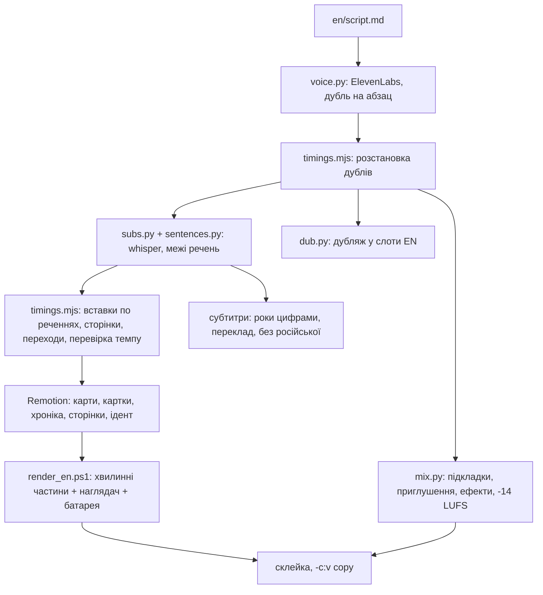

# render-engine

Рушій для документальних фільмів, яким керують конфіги. Ви пишете сценарій, а він його озвучує (ElevenLabs),
знаходить кожне речення в аудіо (whisper), планує монтаж за писаною «біблією» монтажу, малює в Remotion карти й
картки, зводить звук, дублює іншими мовами, робить субтитри і рендерить 25-хвилинний фільм хвилинними шматками,
які переживають навіть розряджений акумулятор ноутбука. Наприкінці картинка і звук склеюються через `-c:v copy`, бо
перекодовувати готовий фільм означає втратити вечір.

[English](README.md) · [Архітектура](docs/ARCHITECTURE.md) · [Бойові історії](docs/LESSONS.md) ·
[Зміни](CHANGELOG.md) · [Як долучитися](CONTRIBUTING.md)

> **Статус: зроблено під один канал, працює на Windows, гострі кути на місці.** Це рушій, на якому зроблено один
> 25-хвилинний історичний випуск. Його витягли й причесали, щоб інші могли прочитати, запустити й позичити ідеї.
> У бою він був рівно один раз. Скрипти розраховують на PowerShell, ноутбук і терплячого власника.

Перший випуск робився для історичного каналу Switchyard. «Сценарна кімната», де писався його сценарій (панель
глядачів і дослідницькі інструменти), це окремий проєкт, поки що не публічний. Цей репозиторій самодостатній:
потрібні йому біблії скопійовано в `docs/bibles/`. Фірмовий вигляд каналу (ідент із сигнальною будкою, штабні карти
на старому папері, залізничний червоний) лежить тут як приклад пресета: `BRAND` і палітра в `src/en/theme.ts`,
а також `brand.tsx`, `Ident.tsx`, `ChannelArt.tsx`, `Thumbs.tsx`. Перейменуйте, перефарбуйте, потяги лишайте на
власний смак.

## Що він робить

- **Голос.** Кожен абзац `en/script.md` (`SPEAKER: текст`, теги ElevenLabs v4 у `[дужках]`) стає окремим дублем.
  Дублі кешуються за хешем моделі, голосу, seed і тексту: змінили один абзац, переозвучився один абзац.
- **Вирівнювання.** faster-whisper розпізнає кожен дубль, а відомий текст сценарію накладається на таймінги слів.
  Так ми знаємо, де починається кожне речення.
- **План монтажу.** `en/timings.mjs` ставить дублі один за одним із вдихами й паузами між розділами, врізає хроніку
  по межах речень (або на сильну долю музики, якщо речення поруч немає), кладе сторінки мемуарів на ті рядки, які
  цитує диктор, вибирає один перехід на склейку за жорсткими квотами і друкує звіт про темп за лімітами з біблії.
- **Картинка.** Remotion малює по одному візуалу на абзац: анімовані штабні карти (кордони 1914 року, берегова лінія
  й річки Natural Earth, рельєф, залізниці, стрілки, фронти), картки (цитати, телеграми, документи, газети, діаграми),
  архівні фото й плівку, скани сторінок із маркером, ідент, розбивки актів, фінальну заставку.
- **Звук.** `en/mix.py` розставляє голос, додає вдихи, яких TTS не робить, проганяє голосовий ланцюжок, кладе
  музичну підкладку на кожен акт, приглушує її під голосом як sidechain-компресор, вимикає її в точках перелому
  сюжету, синтезує звуки ідента й нормалізує все до -14 LUFS.
- **Дубляж.** `en/dub.py` озвучує перекладений сценарій тими самими персонажами й вкладає кожен дубль у його
  англійський слот (прискорюючи щонайбільше до 1.25x), тож картинка не змінюється ніколи.
- **Субтитри.** Прості фрази з відомого тексту на таймінгах whisper, роки цифрами, переклад через локальний
  Claude CLI з кешем, окремі субтитри для дубляжу. Російську код відхиляє.
- **Походження.** `tools/provenance.py` рахує SHA-256 кожного файлу фільму, зводить джерело й ліцензію, пише
  блок титрів і зупиняє рендер, якщо в чогось немає придатної ліцензії.
- **Рендер.** Хвилинні частини з продовженням після збою, наглядач, що перезапускає впалий рендер, і охоронець
  батареї, що заморожує процеси на 15% і розморожує на 40%.

## Що тут нового

1. **Монтаж по реченнях за писаною біблією, з автоматичною перевіркою темпу.** Правила записано прозою
   (`docs/bibles/`): різати на межі речень, не більше 12 наплавів, 3-6 монтажних збігів, один спалах, один
   швидкий перехід, не довше 25 с на карті й 12 с на хроніці. `timings.mjs` перетворює це на номери кадрів і сам
   себе перевіряє, називаючи кожен біт, що порушує ліміт.
2. **Вставки цитованих сторінок, звірені зі сканами.** Коли диктор цитує мемуари, на екрані справжня друкована
   сторінка, і маркер проходить саме по тих рядках. Кожну цитату в `public/docs/memoirs/quotes.json` звірено
   слово в слово зі сканом, рамку виділення виміряно в пікселях зображення.
3. **Дубляж у вихідні таймінг-слоти.** Перекладений дубль міряється проміжком між своїм англійським стартом і
   стартом наступного абзацу і прискорюється рівно настільки, наскільки треба. Одна картинка, п'ять доріжок.
4. **Хвилинний рендер із продовженням і захистом живлення.** 25-хвилинний фільм рендериться як 26 незалежних
   частин; збій живлення коштує щонайбільше хвилину роботи.
5. **Реєстр походження кожного файлу з ліцензійною брамою.** Суспільне надбання проходить, CC BY і BY-SA
   проходять і потрапляють у титри, NC, ND, стокові архіви й невідомі ліцензії зупиняють рендер. Один хеш
   `ledger_root` покриває все, тож будь-хто може перевірити, що опублікований фільм відповідає реєстру.

## Конвеєр



## Швидкий старт (Windows, PowerShell)

Потрібні Node 20+, Python 3.12 (`py -3.12`), ffmpeg/ffprobe у PATH, акаунт ElevenLabs для озвучення і, для
перекладу субтитрів, залогінений Claude Code CLI.

```powershell
git clone https://github.com/heisssen/render-engine; cd render-engine
npm install
py -3.12 -m pip install numpy scipy pillow faster-whisper
copy .env.example .env          # впишіть ELEVENLABS_API_KEY і, за бажання, NARRATOR_VOICE_ID
node scripts/fetch_fonts.mjs    # шрифти Google (OFL) у public/fonts
node scripts/fetch_geo.mjs      # кордони 1914 (historical-basemaps, GPL-3.0)
py -3.12 en/terrain.py; py -3.12 en/bake_relief.py
npm run studio
```

Медіа в репозиторії немає. Карти й картки малюються з даних, тож композиція `MapStills` у Studio покаже всі карти
EP01; повний таймлайн `MainEN` потребує кліпів, фото й сканів, перелік у `public/README.md`. Повна таблиця команд,
формати файлів і чекліст нового випуску: в [англійському README](README.md#command-reference).

## Де лежать дані випуску

У `src/en/story.ts`, `src/en/*.json` (inserts, pages, backdrops, overlays, sentences, timings, photo_aspects),
`en/script*.md`, `en/voice/manifest.json` і трьох маніфестах у `public/`. Шляхи ті самі, що й у продакшені першого
випуску, нічого не переносили, тож усе працює як працювало.

## Немає ліцензії, немає рендеру

`py -3.12 tools/provenance.py [--strict]` пише `out/provenance/en/ledger.jsonl`, `ledger.md`, `credits.txt` і
`summary.json` з `ledger_root`; `render_en.ps1 -Gate` запускає його перед рендером. Модель загроз:
[docs/threat-model.md](docs/threat-model.md), як повідомити про вразливість: [SECURITY.md](SECURITY.md).

## Плани

- **C2PA Content Credentials** (заплановано): підпис фінального mp4 з `ledger_root` усередині.
- **Сайдкари походження для нарізаних кліпів** (заплановано): кожен кліп знає свій вихідний файл і таймкод.

## Набуті уроки (коротко)

- **«No frame found at position»**: перекодуйте кліпи в 30 fps з `-g 30 -bf 0` (`scripts/reencode_clips.py`).
- **Ноутбук двічі вмер на батареї** посеред нічного рендеру. Звідси хвилинні частини й `power_guard.ps1`.
- **Google Fonts відвалювався посеред рендеру.** Тепер шрифти локальні.
- **`Remove-Item` на старому бандлі може зависнути** через блокування файлів. Не видаляйте, бандліть у нову теку.
- **PowerShell 5.1 пише файли в ANSI або UTF-16.** JSON пишемо з Python чи Node.
- **Відносні шляхи в `[IO.File]` рахуються від cwd процесу**; поточна тека PowerShell тут ні до чого.
- **Карти рендерились 4.8 с на кадр**, після оптимізацій 0.9 с.

Повні історії з датами: [docs/LESSONS.md](docs/LESSONS.md).

## Правила дому

- **Жодних ШІ-зображень.** Тільки справжні фото, плівка, картини, карти й сторінки, з підписом джерела.
- **Жодного кінозерна.** Архів і так зернистий.
- **Жодної російської**, ні в дубляжі, ні в субтитрах.
- **Тільки суспільне надбання або CC з атрибуцією**, усе записано в `en/footage.md`.
- **Підпис додає факт.** Якщо титр повторює диктора, його треба прибрати.

## Автор

Автор і супровідник: **Bohdan Oximets**, [heisssen](https://github.com/heisssen). Йому належать
рушій, біблії монтажу і перший випуск, під який усе це будувалося.

## Як цитувати

Метадані для цитування лежать у [CITATION.cff](CITATION.cff), кнопка GitHub «Cite this repository» читає саме їх.

> Oximets, B. (2026). *render-engine* (Version 0.2.0) [Computer software]. https://github.com/heisssen/render-engine

## Ліцензія

Код під MIT, copyright 2026 Bohdan Oximets (heisssen) ([LICENSE](LICENSE)). Дані прикладного випуску, біблії, шрифти (OFL, качаються
скриптом), кордони 1914 року (GPL-3.0, качаються скриптом), музика (Kevin MacLeod, CC BY, не в репозиторії) та архівні
матеріали під MIT не підпадають; подробиці в [англійському README](README.md#licence-and-credits).
